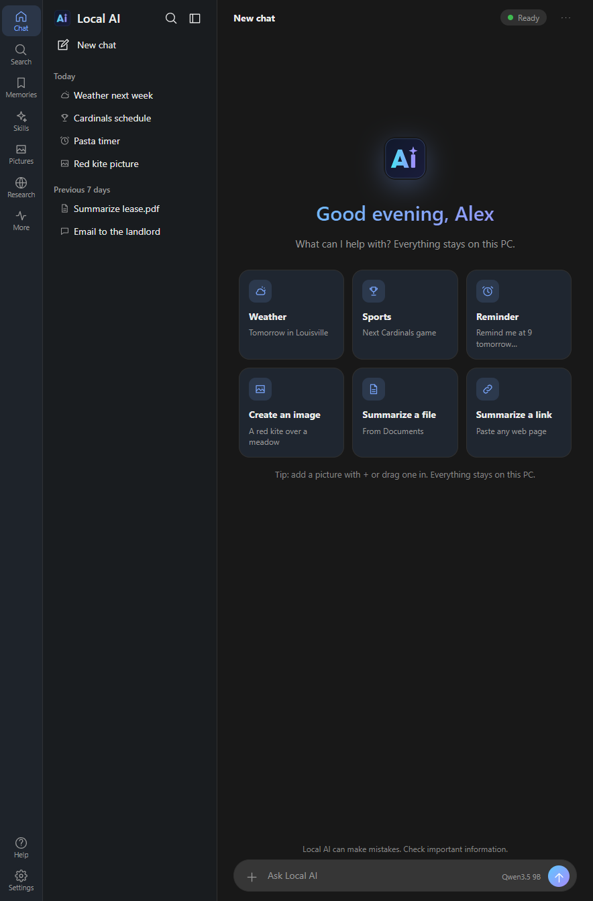
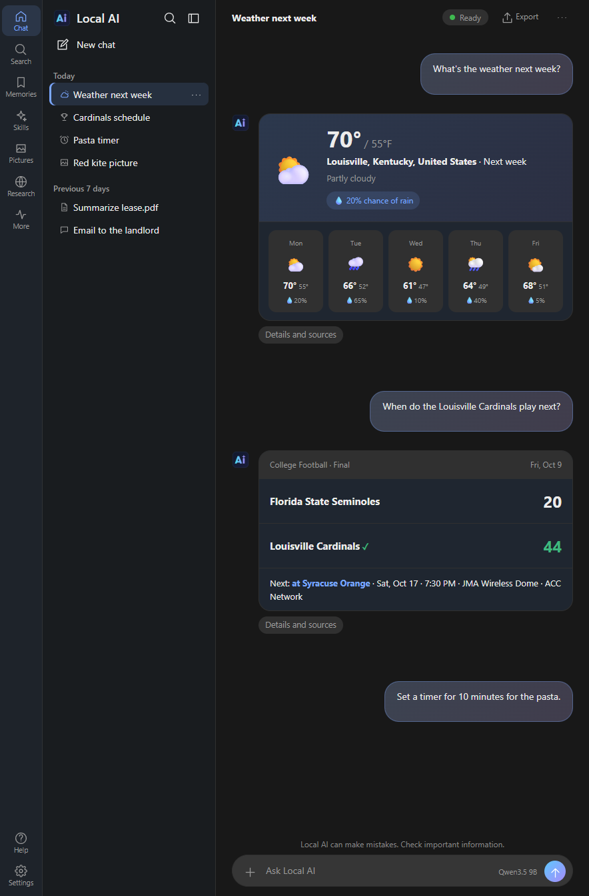
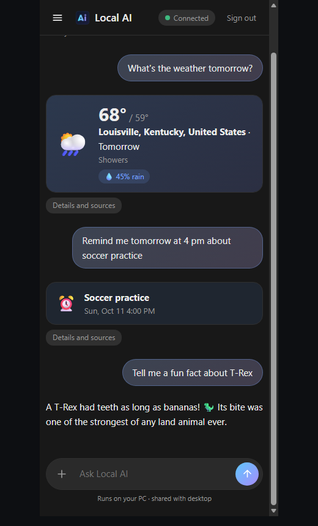
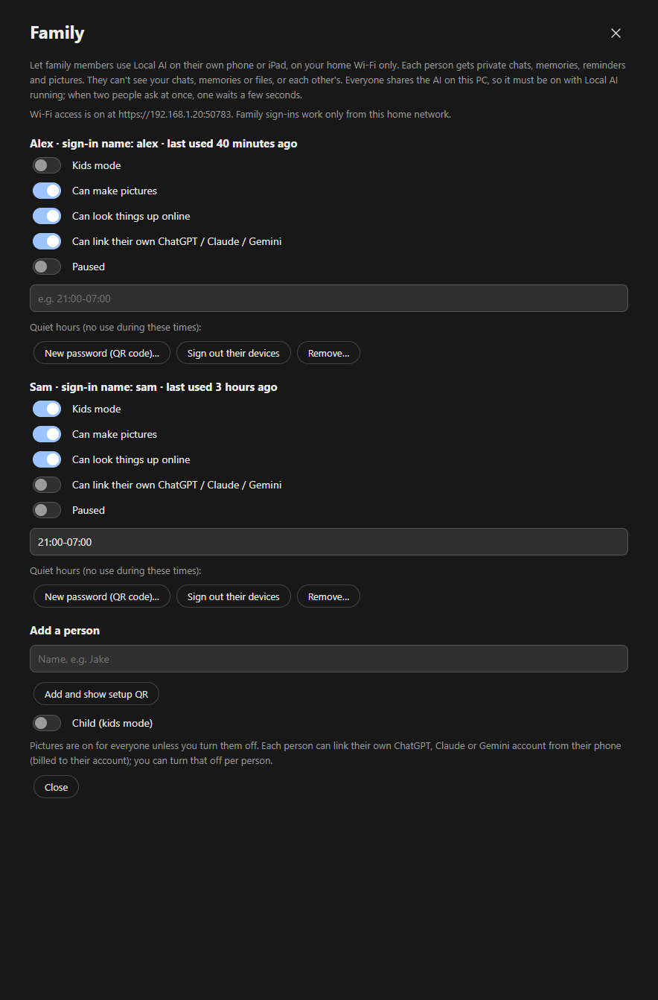

# Local AI

**A private AI assistant that runs on your own Windows PC.** Your chats, memories and files stay on your computer.
It only goes online when it needs to: to look something up for you, to download the AI model you choose, or to use a
cloud AI you linked yourself.

- 💬 Chat, write, translate, explain, summarize: answered by an AI model running on your PC, in short, plain answers
- 🌦️ Live weather, sports scores, news and web answers with sources; it searches by itself when a question needs today's facts
- 🧮 Sums, tips, unit conversions, dates and "days until" worked out exactly, not guessed
- 📄 Ask about your documents (PDF, Word, text, even scans) and search your own files; it changes a file only after you click **Save**
- 🧠 Remembers what you tell it (your name, family, allergies…), and you can see and edit everything it remembers
- ⏰ Reminders, timers, repeating reminders and daily briefings, said in your own words
- 🗣️ Talk to it and hear answers read aloud, even hands-free (optional voice add-on, runs on your PC)
- 🎮 **Workshop**: describe a game or an app and Local AI builds it, play-tests it and lets you use it right away
- 🖱️ **Do it for me**: it can use apps like Notepad, Calculator and File Explorer for you, with your OK
- 🎮 **Game mode**: when you start a game, the AI steps aside so your game gets the whole graphics card
- 🔌 **Connections**: link folders and services (GitHub, Home Assistant and more) and ask about them in normal words
- 🖼️ Create and edit pictures on your PC (optional add-on)
- 📱 Use it from your phone at home or anywhere, and give family members their own private sign-in
- ☁️ Optional: link your own Claude, ChatGPT or Gemini account for chats where you want it

> Local AI is a preview. Answers can be wrong: check anything important.

  
  

  
  

---

## Download and install

1. Download **`LocalAI-Setup-<version>.exe`** from the [latest release](https://github.com/localai-app/local-ai/releases/latest).
2. Run it. Installing doesn't need administrator rights.
3. Follow the setup screens. Local AI checks your PC, recommends an AI model that fits, and downloads it for you.
   Every download is checked against a fixed checksum. Setup can also take your city and favourite teams and set up a
   morning briefing, so it's useful from day one.

The installer isn't code-signed yet, so Windows may say **"Windows protected your PC"**. Choose **More info**, then
**Run anyway**. Each release lists the installer's SHA-256 checksum, so you can verify the file first.

**Updates:** when a new version is out, choose **Update now**. Local AI downloads it, checks it against the published
fingerprint, updates itself and reopens. Your chats, memories and settings are kept.

## What you need

| | Minimum | Recommended |
|---|---|---|
| Windows | Windows 10 or 11, 64-bit | Windows 11 |
| Memory | 8 GB | 16 GB or more |
| Graphics | Not required (runs on the processor, slowly) | A graphics card with 8 GB or more |
| Disk space | About 4 GB | 10–25 GB, depending on the model and add-ons |

Local AI uses Vulkan, so it works with AMD, NVIDIA and Intel graphics.

**More than one graphics card?** The AI spreads across all of them. **Gaming laptop?** It uses the separate graphics
card and skips the slower built-in graphics. **AMD Strix Halo (Ryzen AI Max)?** It uses the large shared memory, so
bigger models fit. You can choose which card to use in **Settings → Speed & answers**.

After the AI loads, Local AI checks that it really fits on the graphics card. If part of it spilled into slower shared
memory, it moves picture reading (and, for some models, a few layers) to the processor and quietly reloads. It checks again every 15 minutes in case
something pushes it out later.

**Tune it for your PC**: **Settings → Speed & answers → Show fine-tune options** lets you choose how long the AI stays
loaded (up to always), see and adjust the graphics card fit, set processor threads, pick an answer style (Precise,
Balanced or Creative) and run a speed test. Chats can be as long as your model supports (up to 128k tokens).

### AI models offered during setup

Setup recommends one for your PC. You can switch later, or use your own `.gguf` file.

| Model | Download | Good for |
|---|---|---|
| Qwen3.5 4B (light) | about 3.4 GB | Smaller graphics cards, built-in graphics, or the processor |
| Qwen3.5 9B (balanced) | about 6.6 GB | Graphics cards with 8–12 GB |
| Qwen3.5 9B (great quality) | about 8.4 GB | Graphics cards with 12 GB or more |
| Gemma 4 26B (best quality) | about 15.4 GB | 16 GB graphics cards or more: smartest at this size, and quick |
| Qwen3.5 27B (large) | about 17.7 GB | 24 GB graphics cards |
| Qwen3.5 35B-A3B (large, fast) | about 22.9 GB | Two graphics cards, or AMD Strix Halo |

Qwen models are Apache-2.0; Gemma models carry Google's Gemma licence. Sizes include the file that lets the AI look at pictures.

---

## What it can do

### Chat and everyday help
- Answers Local AI works out itself show as tidy cards: sums and conversions, weather, sports, Steam prices,
  playtime, your PC's performance, your reminders and schedule, what it knows about you, stocks, crypto and news.
  Your phone shows the same cards. The ⓘ under any answer says in plain words what it used: saved memories, earlier
  chats and web sources.
- Ask anything: explanations, writing and email drafts, translations, ideas. Answers are as short as the question:
  a fact in a sentence or two, steps as a short list.
- Say things your own way, typos and all: "don't let me forget to call Mum at 5", "it's too bright in here",
  "make the text bigger", "google it". If it gets one wrong, reply "no, I meant …" and it learns your wording.
- **Talk to it like a person.** Follow-ups just work: "shorter", "and tomorrow?", "in feet?", "the second one",
  "that's old", "are you sure?", even "?". Tell it how you like replies ("keep your answers short", "be more
  sarcastic", "stop using emojis") and it keeps doing that in every chat. It gives a real pick when you ask for
  one, re-checks before agreeing when you say it's wrong, and never claims it can't do something it can.
- **The same for everyone**: family sign-ins and Discord guests get the same understanding and voice (within their own
- **Small things that add up**: Undo after forgetting a memory, the monthly "Still true?" check on phones, Every day / Weekdays buttons on reminders, and Sources that also show the pages Local AI skipped and why.
- **Better sources, and phones catch up**: questions about who runs or owns something are checked against Wikipedia or a news site; phones get repeat buttons on reminders, family members get repeating reminders, Undo and Sources; Discord guests get clearer answers and fewer repeated quotes.
- **Smarter answers, taught by example**: live prices for gold, oil, currencies and crypto, exact world times and bill splits, more questions looked up instead of guessed, weather questions in everyday words, and plainer web answers.
  limits). Long chats keep a short summary of their start, so a 60-message chat still knows what you decided early on.
  Once a month a "Still true?" card offers memories over a month old to keep or forget; "review my memories" does the
  same in chat. Ask "how do you search?" and it tells you plainly.
- **Sums done exactly**: percentages, tips, discounts and tax, splitting a bill, unit conversions (miles, kg, cups,
  ounces…), temperatures, "how many days until Christmas", and the date and time, all worked out by the app.
- Attach a picture (**+**, paste or drag in) and ask about it. **Ctrl+Alt+S** takes a picture of the window you're
  looking at so you can ask "what does this error mean?". **Ctrl+Alt+A** opens Local AI from anywhere.
- **Helpers** for a chat: Homework helper (hints, not answers), Recipe chef, Tech support, Writing coach, or your own.
- **Try again** and **Edit** work on a copy, so the original chat is kept. Pin chats, put them in projects, search all
  your chats, and export a chat as a file.
- Light or dark theme, or **Match Windows**, with a choice of accent colour and text size.

### Live answers from the web
- **It knows when to look things up.** Anything recent or upcoming (release dates, "the latest", results, who holds a job
  now, prices, store hours, outages, news) goes to the web instead of the AI's older built-in knowledge. If an answer
  gives away that it's out of date, Local AI searches instead, and "that's old" makes it search again.
- **Follow-ups keep the subject**: "when is the next Bengals game?" then "what channel is it on?".
- **Weather**: forecast cards with a week-by-day strip, for the city you saved or any city you name.
- **Sports**: scoreboard cards with the next game, time and TV channel.
- **Near me**: "where's the nearest …" uses your home location.
- **Links**: paste a link and say "summarize this page".
- Answers show their sources by site name. If it can't verify something, it says so instead of guessing.

### Your documents and files
- Drop a PDF, Word or text file on the message box and ask about it ("summarize this", "what does it say about
  refunds?"). Scanned documents and photos of paperwork are read too. Everything is read on your PC.
- Find, read and search files in the folders you allow.
- Ask it to create or change a text file: it shows you the exact text first and saves only when you click **Save**.
  The original is backed up.
- **Folder jobs**: "sort the files in my downloads folder" or "tidy up my pictures". You see every step first, and
  **Undo** puts it all back.
- Folders with passwords, keys and browser data are always off-limits, and you can block any folder.

### Memory
- Tell it things like "Remember that my dog is called Biscuit" or "I'm allergic to peanuts". Ask "am I allergic to
  anything?" or "what's my wife's name?" and it answers from what you told it, never by guessing.
- Saved facts are used when they matter. For example, food suggestions leave out what you're allergic to.
- Open **Memories** to see, edit or delete everything it remembers, and **Undo** any new memory with one click.
- Optional "search model" (0.6 GB) finds memories and earlier chats by meaning, not just exact words, and helps it
  understand everyday wording.
- "What did we talk about yesterday?" looks back through your chats, and "did we ever discuss car engines?" finds the
  chats about a subject. You can turn memory off for a single chat.

### Reminders, timers and briefings
- Say it naturally: "remind me at quarter to 5 to leave", "the day after tomorrow", "on the 25th", "end of the month",
  "10 minute timer", "wake me up at 7".
- Change one just as easily: "snooze it", "make it 6 instead", "an hour earlier", "move it to Monday".
- **Repeating reminders**: "remind me every day at 9 to take my pills".
- **Briefings**: "every morning at 7, give me the weather and my team's next game" runs on schedule in its own chat,
  with a notification.
- **Watches**: "let me know when the new schedule is announced" checks every few hours and only speaks up when something
  changes.
- Windows notifications with **Snooze** buttons, and phone notifications too. Local AI needs to be running for them to
  go off.

### Stocks and crypto
- "watch bitcoin and NVDA", "tell me if ETH drops below 2,000", "tell me if Tesla stock moves 5%", "how's my watchlist?",
  "what's trending in crypto?". Prices only; nothing about what you own.
- Big moves, your own price targets and new 30-day highs or lows become a notification on your PC and phone, a line in
  the Markets chat and, if you connect one, a post in your Discord channel. Alerts wait while you're gaming or overnight.
- Ask in your own words: "how are my stocks looking?", "market update", "stock news", "NVDA news" (headlines with links).
  Answers show as a card with each price, today's move and a 30-day chart.
- **More → Markets** opens your watchlist page: a card for every coin and stock with today's move, a 30-day chart, its
  alerts and a Remove button, plus Add and Refresh. "Every morning at 7, my markets summary" works too.
- **Settings → Markets** holds the watchlist, how sensitive alerts are, Discord alerts and an optional free Finnhub key.
- Only the names or tickers are sent to CoinGecko and Yahoo Finance. Local AI never suggests buying or selling and can't
  trade.

### Talk to it (optional voice add-on)
- **Ctrl+Alt+V** from any app starts hands-free talking.
- Speak your question with the microphone and hear answers read aloud with a natural voice that runs on your PC.
- **Talk hands-free**: just speak, pause, and Local AI answers out loud, then listens again.

### Workshop: make games and apps
- Describe a game or a handy app in your own words. Local AI plans it, builds it, play-tests it, and you can use it
  right away, on your PC or your phone.
- Ask for changes, use **Point and change** to pick the exact part of an app, **Undo** any change, and **Share** it as
  one file anyone can open.
- Web games and apps by default, and 2D or 3D games with a real game engine when you want one.
- Choose Quick, Best quality (an optional bigger builder download) or Claude, if you link it.

### Game mode
- When you start a game from Steam, Epic, EA, Riot, GOG, Ubisoft, Battle.net or Xbox (or any program you add to
  `games.txt`), Local AI steps aside: the AI model is unloaded so your game gets the whole graphics card, and background
  work waits.
- Reminders, sums, dates and your phone keep working. Ask something on the PC and the AI wakes up for the answer, then
  steps aside again a few minutes later. Family phones and Discord guests are asked to try again after the game.
- When the game closes, the AI is ready again within about half a minute. Turn it on or off in **Settings → Gaming**.
- **Playtime**: ask "how long have I played today?", "this week?" or "how long have I played Elden Ring?". An optional
  break reminder nudges you every 2 hours of play (**Settings → Gaming**).
- **Performance helper**: "why is my game stuttering?" or "what's using my RAM?" takes a quick reading of the processor,
  memory and graphics card, then gives plain advice.
- **Steam prices**: "is Hades on sale?" gets the price, any discount and a link, and you can watch a game for a sale.
  Only the game's name is sent to Steam. Discord guests and family phones can ask too.
- **Game clips** (optional, early): after a one-time add-on download, **Ctrl+Alt+C** or "clip that" saves the last
  15 seconds to 2 minutes of your game, with sound, to `Videos\Local AI Clips`. It uses your graphics card's video
  encoder only (tested once in **Settings → Gaming**), never the processor.

### Do it for me (computer use)
- "Open Notepad and write a shopping list", "in Calculator, work out 15% of 240", "in File Explorer, make a folder
  called Taxes".
- You approve the task once; risky steps (deleting, closing without saving) ask every time. An orange border shows where
  Local AI is working, and pressing **Esc** stops it at once. Before saying it's done, it checks the result is really there.
- Works best in Notepad, Calculator and File Explorer; other apps may work but are less tested.

### Connections
- Link Local AI to folders and services from **Settings → Files & web → Connections** (or just say "add a connection"):
  files in a folder, GitHub, Home Assistant, a ready-made setup written for Claude Desktop, or a web address. Services
  that sign in through the browser work too.
- Then ask in normal words, like "what's on the shopping list in My Files?". Anything that changes something shows a
  card with the exact action first: **Allow for this task**, **Always allow**, or **Don't**. Deleting, moving or paying
  asks every time.
- Access keys and sign-ins are stored encrypted, and anything a service sends back is treated as information, never as
  instructions.

### Pictures (optional add-on)
- "Draw me a red kite over a meadow" makes a picture on your PC in about half a minute on a good graphics card. You can
  then say "add a rainbow".
- The image add-on is a separate download (about 6.7 GB, plus 5.3 GB for editing).
- **Pictures** in the left bar shows everything you've made or added.
- With two graphics cards, pictures can be made on one while chat stays ready on the other.

### Phone, tablet and family
- **At home**: chat from your phone's browser on your home Wi-Fi. Scan a QR code, sign in, then use **Add to Home
  Screen**. It has the same look, cards and notifications as on the PC, plus a **Today** screen with your reminders,
  scheduled checks, watchlist and playtime.
- **From anywhere**: **Settings → Phone & sharing → Use from anywhere** lets your phone reach Local AI on any Wi-Fi or
  mobile data, with no router changes. Your phone signs in to Local AI with your own password, and repeated wrong
  passwords lock sign-in for longer and longer. Forgot the phone password? **Reset phone password** signs every phone out and lets you choose a new one.
- **Family**: in **Settings → Phone & sharing → Family**, give each person their own sign-in. They get private chats,
  memories, reminders and pictures. They can't see yours, your files, or each other's.
  - Kids mode gives age-appropriate answers and screens picture requests.
  - Per-person switches cover pictures, web and their own cloud AI account. You can also set quiet hours, pause someone
    instantly, or remove them.
  - Family sign-ins work only on your home Wi-Fi.
- Everyone shares the AI on your PC, which must be on with Local AI running. If two people ask at once, one waits a
  few seconds.

### Optional cloud AI
- Link your own **Claude**, **ChatGPT** or **Gemini** account with an API key, then pick it for a chat from the model
  button beside Send, or tap **Ask … too** under an answer for a second opinion.
- You're asked once before anything is sent. Only that chat's text is sent: never your files, web results or pictures,
  and memories only if you turn that on.
- Keys are encrypted on your PC. Cloud chats are billed by that company to your own account, and you can switch back
  at any time.

### Discord (optional)
- Connect your own Discord bot so people in your server can ask Local AI questions, with web answers, exact sums and
  today's date.
- Guests get a separate, limited assistant with no access to your chats, memories or files.
- Server commands: **/gamenight** (a reminder before it starts), **/lfg** (who's in? then a ping when it's time),
  **/patchnotes** (a weekly summary), **/plans**, **/price** and **/movers** (answered as cards with today's move in
  green or red and the 30-day range).

### Safety and housekeeping
- **Backups**: back up and restore everything in one file, optionally encrypted with a passphrase, or turn on daily
  automatic backups.
- **Updates**: Local AI checks this page once a day and offers **Update now**. Nothing installs without you, and
  **What's new** shows each release's notes afterwards.
- **Help**: the **?** in the left bar explains every feature and keyboard shortcut; each setting has a **What is this?**
  button and says whether it applies right away.
- **Your data folder** has a README.txt explaining what each file is.
- **System health**: a plain "at a glance" view of the model, graphics, phone access, backups and more.
- **Diagnostics**: Help → Save diagnostics makes a file for bug reports. It never includes your chats, memories or files.

### For tinkerers
Local AI starts in a simple mode. Turn on **Show all features** in **Settings → App** for:
- Teaching skills by example.
- Background research on topics you ask about, with a notebook of sources.
- Longer multi-step tasks over approved files.
- Coding help in an approved project folder (on a separate copy).

Idle practice and self-improvement are under **Experimental features**, which is off unless you turn it on.

---

## Privacy

- **Stays on your PC:** your chats, memories, files, documents, pictures, reminders and settings. Chats and memories are
  stored encrypted for your Windows account. Voice, picture creation and the Workshop run on your PC too.
- **Goes online only when needed:**

  | When | Where |
  |---|---|
  | Downloading models or the add-ons you choose | Hugging Face |
  | Checking for and downloading updates | GitHub |
  | Looking things up | DuckDuckGo or Wikipedia (or Brave Search, if you add your own key), then the pages it reads |
  | Weather | Open-Meteo |
  | Sports | ESPN's public data |
  | Software versions | The projects' own release feeds |

- Only the search words and page addresses leave your PC. Your memories, files and chat history are never sent with them.
- **Only if you turn them on:** your own cloud AI account, Connections you add, your Discord bot, and phone, family or
  anywhere access.
- No accounts with us, no analytics, no ads.

## Known limitations

- Windows only. The installer isn't code-signed yet.
- Your PC must be on with Local AI running for phone, family, reminders and briefings to work.
- Speed depends on your graphics card. Without one, answers are slow.
- Do it for me is tested most in Notepad, Calculator and File Explorer.
- The AI can be wrong. Live answers show their sources, so you can check them.

## Licences

Local AI is built on open-source components, including:
- [llama.cpp](https://github.com/ggml-org/llama.cpp) and stable-diffusion.cpp (MIT)
- .NET (MIT)
- Markdig (BSD-2-Clause)
- PdfPig (Apache-2.0)
- SkiaSharp, Discord.Net and QRCoder (MIT)
- Microsoft Edge WebView2
- The Anthropic C# SDK (MIT)

Models are downloaded only when you choose them and carry their own licences (Qwen: Apache-2.0; Gemma: the Gemma
Terms of Use). Full notices are included with the program under **Help → Licences and credits**.
